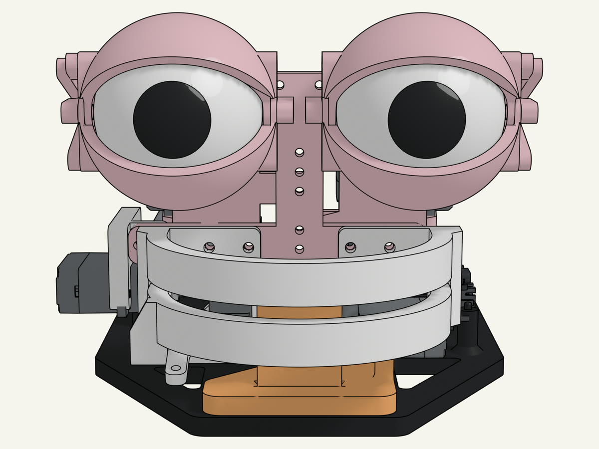
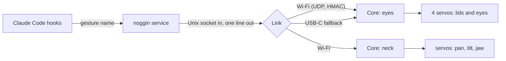

# noggin

[](https://github.com/yellow-pine/noggin/actions/workflows/check.yml)
[](LICENSE.md)
[](pyproject.toml)
[](docs/build-notes.md)
[](https://docs.claude.com/en/docs/claude-code/hooks)

An animatronic Mech on the desk that reacts to Claude Code. A pair of printed eyes with lids
winks when a session starts, drifts while Claude thinks, lights up with a "just thought of
something great" gesture when a response lands, scans the room when Claude needs you, and gets
bored when you walk away. Claude Code hooks feed a small Mac service; the service talks to a
CyberBrick Core that plays the gestures on four servos. The pan-and-tilt base and the mouth are
the next two Stages.

The mechanism is [PurpleShark](https://makerworld.com/en/@PurpleShark)'s three-part CyberBrick
animatronic series on MakerWorld ([eyes](https://makerworld.com/en/models/1718839),
[pan & tilt](https://makerworld.com/en/models/1766064), [mouth](https://makerworld.com/en/models/1861301)):
noggin uses almost all of its printed parts and hardware exactly as designed, and owes its
existence to that work. What this repo adds is the behaviour: the Core program, the Mac service,
the Claude Code hooks, the model and the simulation.



The gestures, posed in the model from the Core program's own commands:

| eureka | attention | bored |
|---|---|---|
|  |  |  |
| **wince** | **wink** | **thinking** |
|  |  |  |

## What it does

| Claude Code event | Mech |
|---|---|
| SessionStart | wink (hello) |
| UserPromptSubmit | thinking: lids low, gaze averted, micro-saccades, a blink every 5-8 s |
| Stop | eureka, sized by how long the turn took: under 20 s small, under 3 min normal, longer big |
| Notification permission_prompt | attention: half lids, a real left-right scan |
| Notification idle_prompt | bored: drooping lids, heavy blinks, one long closure |
| StopFailure | wince |
| SessionEnd | back to rest (a turn with no events for 15 min also returns to rest) |

Several sessions share the one Mech; a gesture already playing wins and later ones are dropped.
Eye movements use real human recordings (GazeBase): every saccade follows a recorded velocity
profile, attention replays a scan, bored a calm viewing window; thinking is synthetic drift built
from those saccades unless `think_trace` is on. Blink and lid timing follow the literature in
`docs/research/`. Calibration is live: `eyes/calibration.json`, pushed to the Core by the noggin
service, tuned with `noggin set`.

## How it works



- **Core program** (`eyes/`): MicroPython on the CyberBrick Core. Holds every gesture and plays it to
  completion on a one-word command, so motion stays smooth whatever the Mac does (ADR 0001). It replaces
  Bambu's stock remote-control program on the Core's filesystem; the firmware is never touched (ADR 0002).
- **noggin service** (`noggin/`, `reactions/`): a launchd process that owns the Link, listens on a Unix
  socket, times each Turn to pick a Tier, and drops Triggers while Busy (ADR 0003). Hooks write one line and exit.
- **Links**: Wi-Fi first, USB-C as the automatic fallback; each Core beacons on the LAN and is addressed
  directly (ADR 0005, PR #30). USB stays the only path for flashing.
- **The model** (`model/`): our own CadQuery parts in four Sub-assemblies and three cumulative Stages, posed by a Python
  simulation engine that sweeps every linkage before a part is printed (ADRs 0004 and 0006, PR #31).

Vocabulary is in `GLOSSARY.md`; decisions in `docs/adr/`.

## Hardware

PurpleShark's three-part CyberBrick animatronic series on MakerWorld:

| Part | MakerWorld model | Stage |
|---|---|---|
| Eyes Animatronic Mechanism | 1718839 | 1, built |
| Pan & Tilt base | 1766064 | 2, printed |
| Mouth | 1861301 | 3, printed |

Electronics are Bambu Lab's CyberBrick kit: a Core (ESP32-C3, MicroPython) on an X11 shield per
Core (eyes, neck), one pack and switch board each, 9 g servos, 2S 14500 packs. Servo ports, power, how to talk to the Core and the calibration
lessons are in `docs/build-notes.md`; the parts to buy, and the Morty face that goes over all three
Stages, in `docs/face-design.md`. The printed parts are not in this repo: get them from MakerWorld.

## Setup

```
scripts/setup.sh     # guided first-run: plug in the Core, back up, flash, join the Wi-Fi, calibrate, install hooks + the noggin service
make install         # host side only: hooks + the noggin service
make start / stop    # (re)start or stop the noggin service; stop frees the Link for mpremote
make flash           # install the eye program on the Core and reboot it
make restore-stock   # put Bambu's remote-control program back on the Core
noggin/noggin status # mode (follow or demo), Link (Wi-Fi or USB) per Core
noggin/noggin off    # mute (on to resume); noggin/noggin eureka 2 for a manual gesture
noggin/noggin pose lids 0.3 eyes 95     # hold a pose while you look
noggin/noggin set lid_rest 0.3           # live calibration, saved to eyes/calibration.json
noggin/noggin exercise 10                # gentle run-in, 10 minutes
make demo            # demo mode: every gesture on a loop, 5 s apart, hooks ignored (ARGS=once, ARGS="bored 2")
make follow          # follow mode: react to Claude Code again (the default, and the mode after any restart)
```

Requirements: macOS, [uv](https://docs.astral.sh/uv/) (Python 3.12 and mpremote come with it),
Claude Code. Never flash firmware with esptool; the Core is bricked by it.

## Development

`make check` runs everything CI runs: tests, wizard and hook script syntax, plist validity. Tests sit
beside the code (`eyes/test_eyes.py`, `noggin/test_service.py`, ...). Work runs in a fixed cycle
(grilling, research, plan, TDD, code review, PR, retro) with one PR per concern; see
[CONTRIBUTING.md](CONTRIBUTING.md).

## The model


`model/` is the Mech as code, simulated in Python (PR #31):

- Four sub-assemblies own the parts once (base, stack, eyes, mouth); three Stages place them at frames:
  Stage 1 = base + eyes, Stage 2 = + stack on the tilt arm, Stage 3 = + mouth (ADR 0004).
- A Python simulation engine (`model/engine/`, run by `make sim`): planar four-bar solver, rigid mesh
  transforms, KD-tree contact screen, mass and torque, the electrical budget, in seconds. Blender renders
  every picture from the engine's poses (ADR 0006).
- Our own parametric CadQuery parts (`model/printed/`) and hardware envelopes (`model/envelopes.py`), so CI
  simulates the Mech with none of the designers' files; every picture draws them.

Rendering rules are in `docs/model-notes.md`.

## Roadmap

- Stage 2 (pan-and-tilt) and Stage 3 (mouth) on the desk; parts are printed, the rest is ordered.
- Wireless Links checked live with both Cores on the Wi-Fi (PR #30).
- The Morty face: three screw-on modules, one per Stage (`docs/face-design.md`, parked).

## Acknowledgements

- PurpleShark's CyberBrick animatronic series on MakerWorld:
  [eyes](https://makerworld.com/en/models/1718839) (1718839),
  [pan & tilt](https://makerworld.com/en/models/1766064) (1766064),
  [mouth](https://makerworld.com/en/models/1861301) (1861301).
- Bambu Lab's [CyberBrick](https://wiki.bambulab.com/en/cyberbrick) Core, shields and MicroPython build.
- [GazeBase](https://doi.org/10.1038/s41597-021-00959-y) (Griffith et al., CC BY 4.0) for the recorded eye movements.
- Duke Doks' [Morty head](https://makerworld.com/en/models/1455413) (MakerWorld 1455413), the reference for the face.

## Licence

[PolyForm Noncommercial 1.0.0](LICENSE.md), copyright Yellow Pine. You may use, change and share
noggin for any noncommercial purpose; contact hello@yellowpine.com for commercial licensing.

The MakerWorld models carry their own licences and are not redistributed here; `docs/references/`
(the designers' files and the GazeBase cache) is local only and gitignored.
