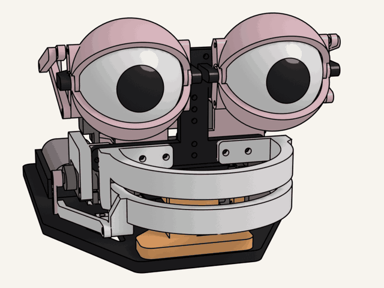
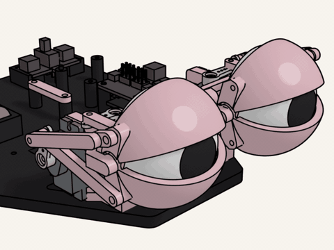
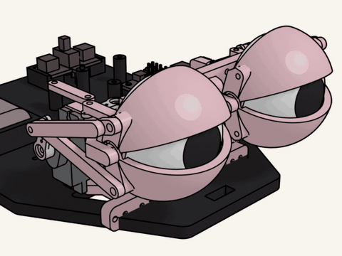
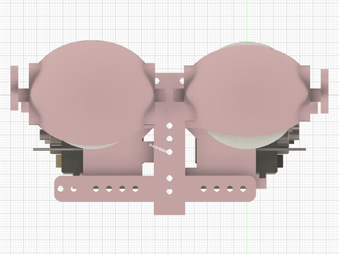
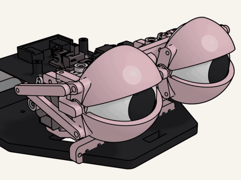
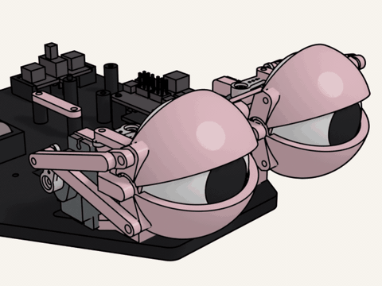
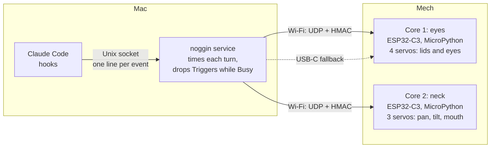
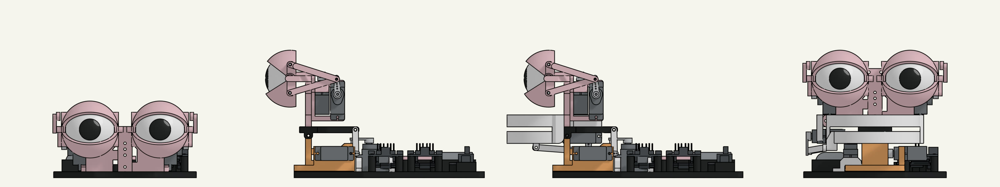
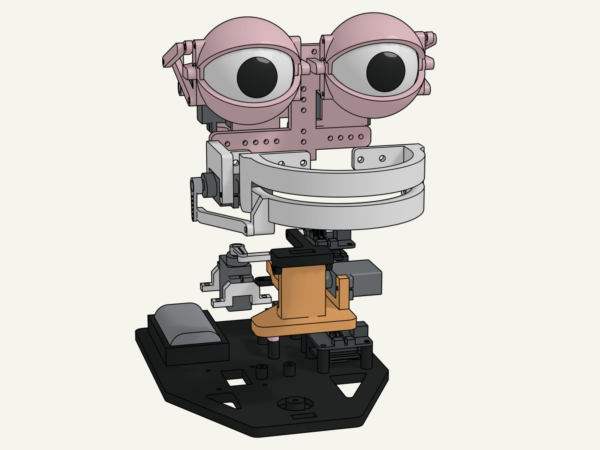

# noggin

[](https://github.com/yellow-pine/noggin/actions/workflows/check.yml)
[](https://github.com/yellow-pine/noggin/actions/workflows/review.yml)
[](https://github.com/yellow-pine/noggin/commits/main)
[](LICENSE.md)
[](https://github.com/yellow-pine/noggin/blob/main/pyproject.toml)

An animatronic Mech on the desk that reacts to Claude Code. It winks when a session starts, drifts while Claude
thinks, lights up when a response lands, scans the room when Claude needs you and gets bored when you walk away.
Claude Code hooks feed a small Mac service, the noggin service, which tells the Mech's two Cores what to play.



Turn it around and play its gestures in the browser: [the web viewer](https://yellowpine.com/noggin/viewer/). These
docs are on [the site](https://yellowpine.com/noggin/) too.

## Acknowledgements

The mechanism is [PurpleShark](https://makerworld.com/en/@PurpleShark)'s three-part CyberBrick animatronic series on
MakerWorld: [eyes](https://makerworld.com/en/models/1718839) (1718839),
[pan & tilt](https://makerworld.com/en/models/1766064) (1766064) and
[mouth](https://makerworld.com/en/models/1861301) (1861301). noggin owes its existence to that work; what this repo
adds is the behaviour (the Core program, the noggin service, the hooks) and the model (our own parametric parts and a
simulation of the Mech).

- Bambu Lab's [CyberBrick](https://wiki.bambulab.com/en/cyberbrick) Core, shields and MicroPython build.
- [GazeBase](https://doi.org/10.1038/s41597-021-00959-y) (Griffith et al., CC BY 4.0) for the recorded eye movements.
- Duke Doks' [Morty head](https://makerworld.com/en/models/1455413) (MakerWorld 1455413), the reference for the face.

Built with
[](https://docs.claude.com/en/docs/claude-code)
[](https://cadquery.readthedocs.io)
[](https://www.blender.org)
[](https://micropython.org)

## Gestures

| eureka | attention | bored |
|---|---|---|
|  |  |  |
| **wince** | **wink** | **thinking** |
|  |  |  |

## What it does

<!--{{ behaviour }}-->

<!--{# GitHub shows the line below; the site drops it for the table above, which it builds from the code -->
Which Claude Code event plays which gesture is in [the table on the site](https://yellowpine.com/noggin/#what-it-does),
built from the code.
<!-- #}-->

Several sessions share the one Mech; a gesture already playing wins. Eye movements replay real human recordings
(GazeBase); blink and lid timing follow the literature in `docs/research/`.

## How it works



Arrows carry commands, the dotted one only when Wi-Fi fails; each Core plays a gesture to its end.

The gestures live on the Core, so motion stays smooth whatever the Mac does; the Mac only says which one. The Link,
a hook's way to a gesture and the model's pipeline are drawn in [`docs/how-it-works.md`](docs/how-it-works.md).
Decisions are in [`docs/adr/`](https://github.com/yellow-pine/noggin/tree/main/docs/adr), the words in
[`GLOSSARY.md`](GLOSSARY.md).

## Quick start

```
scripts/setup.sh       # guided first run: plug in the Core, back up, flash, join the Wi-Fi, calibrate, install
noggin/noggin status   # mode and Link per Core
make demo              # every gesture on a loop
make follow            # react to Claude Code again
```

macOS, [uv](https://docs.astral.sh/uv/) and Claude Code. Every command, the hardware and the calibration lessons are
in [`docs/build-notes.md`](docs/build-notes.md); how work runs in [`CONTRIBUTING.md`](CONTRIBUTING.md).

## The Stages and the model





The Mech grows in three Stages: the eyes on the base, then on the pan-and-tilt neck, then with the mouth. `model/` is
the Mech as code: our own parametric CadQuery parts, a simulation (MuJoCo, ADR 0007) that sweeps every linkage,
finds its collisions and the supply's voltage sag (SPICE) before a part is printed, and Blender pictures from
MuJoCo's trajectories (every picture here). How the pictures are made: [`docs/model-notes.md`](docs/model-notes.md).

## Licence

[PolyForm Noncommercial 1.0.0](LICENSE.md), copyright Yellow Pine. You may use, change and share noggin for any
noncommercial purpose; contact hello@yellowpine.com for commercial licensing. The designer's models carry their own
licences and are not redistributed here.
