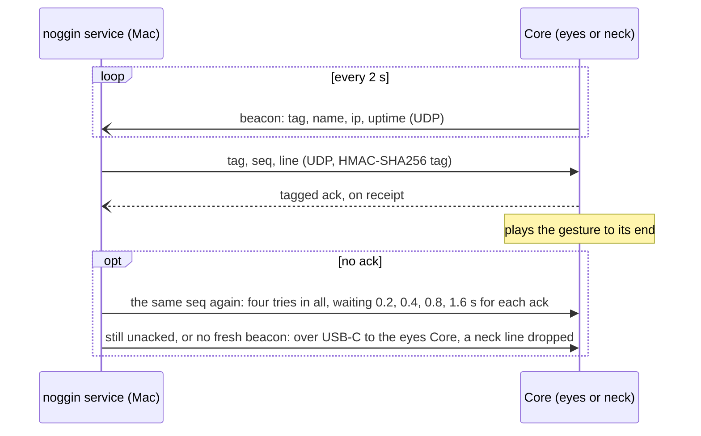
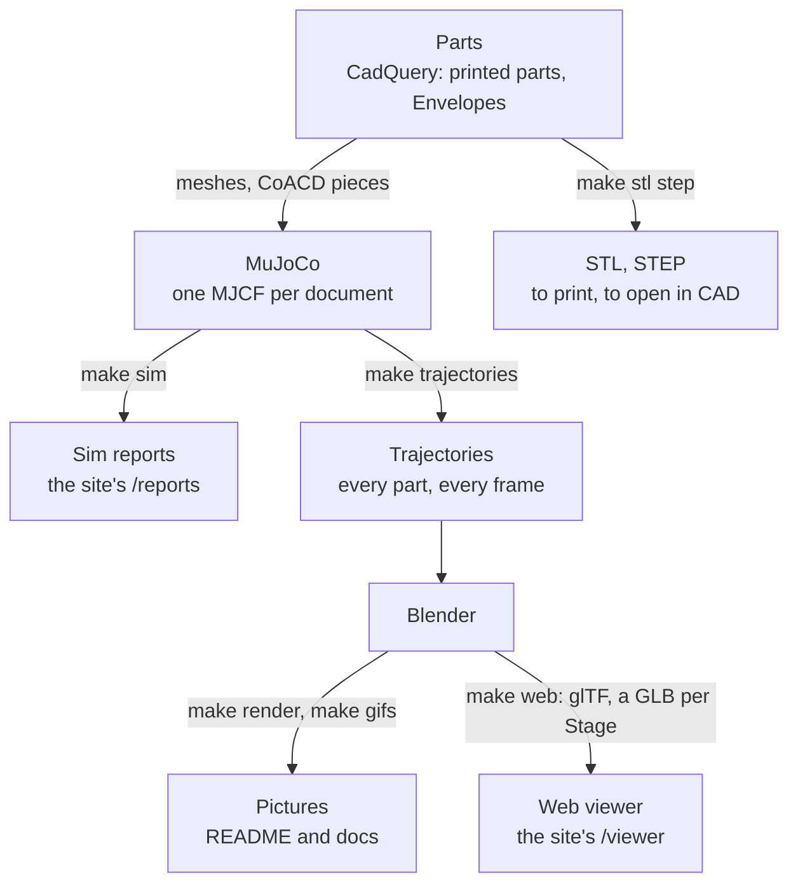

# How it works

Three closer looks behind [the README's overview](../README.md#how-it-works): the Link that carries each command to a
Core, how a Claude Code hook becomes a gesture, and how the model makes every picture. The words are the
[glossary's](../GLOSSARY.md).

## The Link

Every datagram both ways carries an HMAC tag under the shared token, and the seq never goes back, so a replayed or
forged line is dropped (ADR 0005).

## From a hook to a gesture

```mermaid
---
config:
  layout: dagre
  look: classic
---
stateDiagram-v2
    accTitle: From a Claude Code hook to a gesture
    accDescr: The Mech rests until a prompt starts a turn and it thinks. A Trigger that plays a gesture interrupts rest or thinking; while the gesture plays the noggin service is Busy and drops Triggers. When it ends the Mech thinks if a turn is still open, else rests. The last turn ending with no gesture (SessionEnd, or a Stop while Busy), or a last turn 15 min old returns it to rest.
    [*] --> Rest
    Rest --> Thinking: UserPromptSubmit
    Rest --> Gesture: a gesture's Trigger
    Thinking --> Gesture: a gesture's Trigger
    Gesture --> Thinking: played to its end, a turn still open
    Gesture --> Rest: played to its end, no turn open
    Thinking --> Rest: the last turn ends with no gesture, or is 15 min old
    note right of Gesture
        SessionStart: wink
        Stop: eureka, by the turn's Tier: under 20 s small, under 3 min normal, longer big
        StopFailure: wince
        Notification: attention (permission), bored (idle)
        Busy for 2.5-9 s: Triggers dropped
    end note
```

The noggin service decides (reactions/director.py); the Core plays (ADR 0001).

## The model's pipeline

MuJoCo simulates and Blender draws (ADR 0007, ADR 0008); CI builds the reports and the viewer and the site serves them
(ADR 0009).
