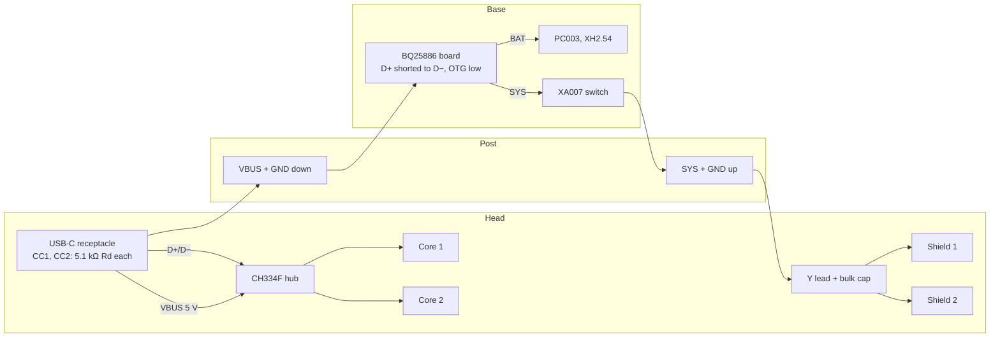

# USB-C power and data for the Mech (#51)

Researched 2026-11-03. Purpose: Cansin's split, with the pack, its switch and a USB-C charger in the base, and in the head
both Cores, both Shields, the seven PG001 servos and one USB-C port feeding both Cores. Can a USB-C link (5 V, or more
than 5 V by USB Power Delivery) carry the Mech's power up the post, and what does a laptop on that port run?

Builds on `2026-10-31-electrical.md` (part figures), `2026-11-02-literature-electrical.md` (pack sag, start budget) and
`docs/build/wiring.md` (today's power path). Those figures are not repeated here, only used. [I] marks inference.

Sources:
- [PG] Bambu B-PG001 spec sheet, as quoted in `2026-10-31-electrical.md` (Clutch section).
- [SH] Shield XA004 spec, as quoted in `2026-10-31-electrical.md` §2.
- [CO] Core XA003 store page and the receiver manual, as quoted in `2026-10-31-electrical.md` §5. The store pages return
  HTTP 402 to fetches, so they were not re-read today.
- [BAT] PC003 spec sheet, re-read today: https://store.bblcdn.com/s2/default/ea2b2a3f6cbd44ce940642d1c1f9d3e0/14500_7.4v_800mah_li-ion_battery_1pcs-pc003.pdf
- [KIT] Bambu "All-in-One Fast Charging Kit for CyberBrick" specs (XB006 charger, XB003 battery charger), via the
  reseller listing https://www.3dsaga.com/en/products/bambu-lab-all-in-one-fast-charging-kit-for-cyberbrick (the
  Bambu store page, https://eu.store.bambulab.com/products/7-4v-lithium-battery-charger-with-xh2-54-connector-1pcs, is
  JS-rendered and returned no text).
- [TC] USB-IF, USB Type-C Cable and Connector Specification R2.0 (Aug 2019), §4.6 (source current advertisement):
  https://www.usb.org/sites/default/files/USB%20Type-C%20Spec%20R2.0%20-%20August%202019.pdf
- [IP] Injoinic IP2368 datasheet V1.2 (2–6S bidirectional buck-boost, PD3.0, 100 W): https://nikom.biz/pic_info/A429020/IP2368.pdf
- [IPM] IP2368 boards on sale, e.g. Teyleten Robot "IP2368 Bidirectional 100W Fast Charging Module" (sold on Amazon;
  reseller copy https://www.desertcart.co.uk/products/466649119-teyleten-robot-ip2368-bidirectional-100w-fast-charging-module-buck-boost),
  listed $12–20 and shipped set for 4S 60 W.
- [ST] ST STUSB4500 datasheet DS12499 (standalone PD sink, NVM-configured): https://cdn.sparkfun.com/assets/b/6/e/8/9/DS-15801-STUSB4500.pdf ;
  board: SparkFun Power Delivery Board USB-C (Qwiic) DEV-15801, $31.92, https://www.sparkfun.com/sparkfun-power-delivery-board-usb-c-qwiic.html
- [HU] Hynetek HUSB238 datasheet (D+/D- are used for Apple divider 3 and BC1.2): https://cdn.sparkfun.com/assets/9/1/7/a/4/USB_PD_Sink_HUSB238.pdf ;
  board: Adafruit HUSB238 USB-C PD Dummy Breakout #5807, $5.95, 24.5 × 20.2 × 4.9 mm, https://www.adafruit.com/product/5807
- [CH] WCH CH224 datasheet V2.0 (CH224Q/CH224A: PD3.2 sink with PPS and AVS, PPS only via I²C register 0x0A=6, voltage in 0x53):
  https://w2.electrodragon.com/Chip-cn-dat/WCH-dat/CH224-dat/CH224-dat.md (mirror of WCH's PDF; check wch.cn).
- [AP] Diodes AP33772 datasheet (PD3.0 PPS sink, 20 mV / 50 mA steps, I²C): https://diodes.com/datasheet/download/AP33772.pdf
- [HUB] Adafruit CH334F Mini 4-Port USB Hub Breakout #5997, $4.95, 31.6 × 20.4 × 4.8 mm, USB-C upstream, downstream
  ports as 5V/D+/D-/GND pads: https://www.adafruit.com/product/5997 , guide https://learn.adafruit.com/adafruit-ch334f-mini-4-port-usb-hub-breakout ;
  2-port version #5999 (size and price not checked).
- [POL] Pololu S7V7F5 5 V step-up/step-down regulator #2119: 2.7–11.8 V in, about 1 A out stepping down, 9 × 12 × 3 mm,
  $8.49: https://www.pololu.com/product/2119
- [IP26] Injoinic IP2326 (2/3S boost charger from 5 V USB, 15 W, integrated 2-cell balancing), LCSC datasheet (Chinese):
  https://wmsc.lcsc.com/wmsc/upload/file/pdf/v2/lcsc/2304062030_INJOINIC-IP2326_C2832094.pdf
- Apple publishes no figure for what a Mac's USB-C port supplies to a device (searched support.apple.com). Forum posts
  claim 15 W on the first port and 7.5 W on the others, but that is unverified.

Added for §7 (the UPS board), all read 2026-11-03:
- [886] TI BQ25886 datasheet SLUSD88A (standalone 2S boost charger, NVDC power path): https://www.ti.com/lit/ds/symlink/bq25886.pdf ;
  product page https://www.ti.com/product/BQ25886 ; EVM BQ25886EVM, DigiKey https://www.digikey.com/en/products/detail/texas-instruments/BQ25886EVM/10273242
  (CHF 96.40 on digikey.ch, $118.80 on hotenda.com; US price not shown to a fetch).
- [NOMO] Tindie "2s Lithium ion Battery Charge Board 18650" by nomo (UK), a BQ25886 board, $37.50:
  https://www.tindie.com/products/selftaught/2s-lithium-ion-battery-charge-board-18650-bq25880/
- [883] TI BQ25883 datasheet SLUSDL3A (the I²C sibling): https://www.ti.com/lit/ds/symlink/bq25883.pdf
- [887] TI BQ25887 product page: https://www.ti.com/product/BQ25887
- [798] TI BQ25798 datasheet SLUSDV2C (1–4S buck-boost, NVDC, backup mode): https://www.ti.com/lit/ds/symlink/bq25798.pdf ;
  PD reference board USB-PD-CHG-EVM-01 (BQ25798 + TPS25751): https://www.ti.com/tool/USB-PD-CHG-EVM-01
- [713] TI BQ25713 product page: https://www.ti.com/product/BQ25713
- [639] MPS MP2639A datasheet (distributor copy): https://datasheet.chipsmall.com/MP2639AGR-Z/168118.pdf
- [672] MPS MP2672A datasheet Rev 1.0: https://cdn.sparkfun.com/assets/4/6/7/5/6/MP2672A_datasheet.pdf
- [5389] Injoinic IP5389, LCSC listing (2–5S power-bank SoC, QFN-64 8×8): https://www.lcsc.com/product-detail/C42411073.html
- [CN] Consonance CN3302 (PFM boost 2S charge controller, 2.7–6.5 V in), datasheet mirror:
  https://w2.electrodragon.com/Chip-cn-dat/CONSONANCE-dat/CN3302-dat/CN3302-dat.md (not fully read).
- [UPS] Ready-made "2S UPS" listings, from search snippets only (the pages sit behind Cloudflare and refused fetches):
  sigmanortec.ro "Bidirectional UPS Module, compatible with 2S Lithium, 9–10V"; EGBO "2S V4.0CN" UPS board (AliExpress
  item 1005010228923187, manual on manuals.plus); generic "2S Type-C to 8.4V step-up boost charger" modules (fruugo,
  robu.in, Walmart).

Added 2026-11-04 for the input limit that follows the source (Cansin, #858):
- [320] TI TUSB320 datasheet SLLSEN9F (USB Type-C CC logic, GPIO mode): https://www.ti.com/lit/ds/symlink/tusb320.pdf ;
  §7.3.1.2 (UFP), §7.3.4 and Table 7-3 (OUT1/OUT2). No breakout board was found (one search, 2026-11-04).

## 1. Power: what each part takes

| Part | Takes | Source |
|---|---|---|
| Core XA003 | USB-C 5 V; separately VBAT 3.7–12.6 V from the Shield | [CO] |
| Shield XA004 | 7.4–12.6 V (2S–3S) on XH2.54 2-pin; standby 60 mA, working 200–300 mA, max 3 A | [SH] |
| Shield servo ports | "universal 5V servo": a regulator, type and current limit unpublished | [SH] |
| PG001 servo | 4.8–6 V; stall ≤ 550 mA @ 4.8 V, ≤ 650 mA @ 6 V; no-load ≤ 50/60 mA; standby 8 mA @ 6 V; power cut after 5 s stall | [PG] |
| Pack PC003 | 2S 14500, 7.4 V nominal, 8.4 V full, 5.8 V cutoff; 3 A continuous; 2-pin XH2.54 with **no balance lead**; charge 160 mA standard, 800 mA max | [BAT] |

- **The premise needs one correction: the servos never see 7.4 V.** They run on the Shield's regulated 5 V rail. The
  7.4 V pack feeds the Shield's input, which accepts anything from 7.4 to 12.6 V [SH]. So the head needs a supply
  inside 7.4–12.6 V at the Shields. That supply does not have to be 7.4 V exactly. **A 9 V PD contract goes straight
  into the Shields, with no step-down** [I, from SH].
- **The Core's USB-C does not reach the servo rail.** On today's build, USB-C powers only the Core (`docs/build/wiring.md`,
  observed; the docs never state it [CO]). A USB-C link at 5 V therefore runs the Cores but not one servo, unless the
  Shields' input gets 7.4 V or more by some other path.
- **Torque, and `model/sim.py` `RATED_KGF_CM = 0.4`.** The 0.4 figure is the PG001's rated torque at 6.0 V [PG]. On the
  Shield's 5 V rail the vendor's two points (0.32 @ 4.8 V, 0.4 @ 6.0 V) interpolate to **about 0.33 kgf·cm rated and
  1.03 kgf·cm stall** [I, linear interpolation]. That holds for every option below, because every one keeps the servos
  on the Shield ports. Today's model therefore overstates the rated torque by about 20%, whatever the USB scheme.
  - Only a separate 6 V servo rail that bypasses the Shields would earn 0.4. That means rewiring the servo leads and is
    not recommended (§5, option E).
  - What the 5 V rail actually measures is not known: the regulator type and its dropout are unpublished [SH]. The
    model's 3.65 V rail at a 5.8 V pack (`model/electrical.py`) treats it as a low-dropout regulator.
  - A regulated supply above 7.4 V (PD 9 V) keeps that rail at its 5 V down to an empty pack, where today it sags with
    the pack. That would cure the designer's "sluggish when the battery is low" [I].
- **Current the Shields need** (servo stall ≈ 0.57 A each at 5 V, interpolated; Shield plus Core ≈ 0.3 A each [SH]).
  Whether the Shield's regulator is linear (input current equals servo current) or switching (assumed 85%) is unknown,
  so both columns are shown [I]:

| Load | Linear: A at Shield inputs | at 7.4 V | at 9 V | Switching: A at 9 V (W) |
|---|---|---|---|---|
| Both Shields idle, Wi-Fi | 0.6 | 4.4 W | 5.4 W | 0.6 (5.4 W) |
| Start budget, 4 servos at stall (2 per Core) | 2.9 | 21 W | 26 W | 2.1 (19 W) |
| All 7 at stall | 4.6 | 34 W | 41 W | 3.2 (29 W) |

  - A 9 V 3 A (27 W) contract carries the start budget in either case, but not all seven at stall.
  - A 20 W charger such as Bambu's own XB006 (9 V 2.22 A [KIT]) carries the start budget only if the regulator is
    switching. Otherwise budget 3 starts.
  - With a linear regulator, 9 V costs 22% more power than 7.4 V for the same servo work, burned as heat in the Shields
    [I]: about (9 − 5) × 1.15 A ≈ 4.6 W per Shield during a two-servo start, against 2.8 W at 7.4 V. That heat is brief,
    and no thermal limit for the Shield is published.

## 2. The head: sink, hub and splitter

What a USB-C port in the head has to do: take VBUS (5 V from a laptop, 9 V from a PD source), hand D+/D- to a hub
serving both Cores, and give the Shields 7.4–12.6 V only when the source offers it.

- **PD sink: STUSB4500, not HUSB238 or CH224K.**
  - The STUSB4500 negotiates its stored PDOs standalone, from NVM, with no MCU [ST]. It works on CC alone, which leaves
    D+/D- free for data [I, from ST's block diagram; check the pin table].
  - It has a VBUS switch gate driver. SparkFun's library exposes "power only above 5 V", so with a 5 V-only laptop the
    Shields stay off rather than browning out at 5 V [I, unverified against the NVM map].
  - HUSB238 [HU] (and CH224K, by the same family behaviour [I]) also drives D+/D- for BC1.2/Apple charger signalling,
    which contends with USB data on the same pair. Use them only where no data shares the cable.
  - Board: SparkFun DEV-15801, $31.92, 5–20 V, up to 5 A, I²C/Qwiic config [ST]. Its dimensions, and whether it breaks
    out D+/D-, are not on the page (unverified). If it does not, put the STUSB4500 behind a separate receptacle breakout
    that exposes D+/D-, CC1/CC2 and VBUS, which means small custom wiring.
- **Hub: Adafruit CH334F**, 4-port #5997 (31.6 × 20.4 × 4.8 mm, $4.95) or 2-port #5999 [HUB].
  - USB 2.0 is enough: the Cores' ESP32-C3 USB is full speed [I].
  - Downstream ports are pads, so each Core needs a short USB-C plug pigtail.
  - Neither Amazon US nor Bambu sells an equivalent bare hub (Bambu sells no hub at all). Adafruit sells direct.
- **Hub power:** VBUS can be 5 V or 9 V, and the hub and the Cores' USB inputs want 5 V. A Pololu S7V7F5 buck-boost (2.7–11.8 V in, 5 V
  about 1 A out, 9 × 12 × 3 mm, $8.49 [POL]) makes 5 V from either. Do not set 12 V PDOs: that exceeds its 11.8 V.
- **"PD pass-through" hubs are the wrong product.** A consumer hub with a PD-in port sends charger power *up* to the
  host laptop. It does not send it down to devices, and its downstream ports are 5 V [I, general product behaviour,
  not tested]. No off-the-shelf hub takes 9 V on its upstream port and splits it into power plus data. The head needs
  the sink, the hub and the buck-boost as three boards.

## 3. The base

- **Charging the pack from USB-C.**
  - The pack has no balance lead [BAT], so no charger can balance it. The pack's own protector caps each cell's charge
    (8.4 V overcharge [BAT]). "Balance-charging" is not available with PC003.
  - Charge at 800 mA or less [BAT]:
    - **Owned, zero cost:** Bambu XB003, USB-A 5 V in, 7.4 V 0.5 A out on XH2.54 [KIT]. It needs a USB-A socket, or a
      C-to-A adapter, so it gives no USB-C port on the base.
    - **IP2326 board** (5 V USB-C in, boost to 2S, 15 W) [IP26]. Commodity modules on Amazon ("Type-C 2S 8.4V boost
      charger") are typically set to 1–1.5 A, above the pack's 0.8 A max. Pick one that states ≤ 0.8 A or swap its set
      resistor (unverified per listing). It charges only and sources nothing.
    - **IP2368 board** (§3, PD source): charges and sources from one USB-C port.
- **Feeding the head: three ways.**
  - (a) **The pack pair straight up** (two 26 AWG wires, about 2 mm, as today's Y lead). No conversion, and the most
    current for the servos from the same pack.
  - (b) **A 2S → 9 V PD source** on a USB-C cable up the post. A boost or buck-boost is needed, because the pack runs
    from 8.4 V down to 5.8 V.
    - The part that fits is the **IP2368**: 2–6S set by a resistor on BAT_NUM, PD3.0 in and out, fixed PDOs 5/9/12/15/20 V
      [IP]. **PPS output is "customization" only** [IP].
    - Modules [IPM] ship as 4S 60 W, so resistor swaps are needed for 2S (BAT_NUM) and for current (ISET).
    - Charge current: ISET_MODE to GND gives I = 0.2 × R_ISET (mA, R in Ω; 5 kΩ = 1 A, 100 mA steps) [IP]. For 0.8 A,
      R_ISET ≈ 4 kΩ, which is below the table's lowest row (unverified).
    - **The same ISET pin also sets the C-port output power** [IP]. One resistor can therefore set both the pack-safe
      charge current and the output limit only with the I²C variant or by testing [I]. This is a real snag with an
      800 mAh pack on a 100 W chip.
  - (c) **A 2S → 5 V buck** on USB-C. It runs only the Cores and cannot drive the Shields (§1), so it is rejected.
- **The pack limit under (b).** Source power comes out of the pack at P / η / V_pack. A 27 W contract draws
  27 / 0.93 / 7.4 ≈ 3.9 A, and 4.5 A at 6.5 V, both over PC003's 3 A continuous [BAT; η 93% assumed, I].
  - Cap the base's PDO at **9 V 2 A (18 W)**, which is 3.0 A from the pack at 6.5 V.
  - In the linear case that 18 W carries only about 2 servo starts at once (2 × 0.57 + 0.6 = 1.7 A × 9 V = 16 W), half
    of today's start budget. In the switching case it carries 3 to 4 [I].
  - Way (a) moves the same 3 A at pack voltage with no loss, so **from the same pack, a PD hop gives the servos less, not
    more** [I].

## 4. PPS at 7.4 V against fixed 9 V

| | PPS, sink asks 7.4 V | Fixed 9 V, straight into the Shields | Fixed 9 V, stepped down to 7.4 V |
|---|---|---|---|
| Head sink | CH224Q [CH] or AP33772 [AP]: **PPS only via I²C**, so an MCU must write the request after every attach | STUSB4500, standalone NVM [ST] | STUSB4500 plus a buck (a 9→7.4 V, 3 A buck is one more board) |
| Who drives I²C | A Core, but the Cores are powered from the Shields, which wait on the contract (chicken and egg unless the hub's 5 V boots a Core first) [I] | nobody | nobody |
| Base source | must offer PPS: IP2368's PPS is custom-only [IP]; no stock 2S PPS source board found | any PD source (IP2368) | any |
| Wall charger | must be PPS-capable (common on Samsung and Anker; Apple's not confirmed) | any PD ≥ 9 V 2–3 A, including Bambu XB006 (9 V 2.22 A [KIT]) | any |
| Servo gain | none: the rail is 5 V either way | none | none |
| Shield heat (if linear) | lowest | +22% | lowest |

**Fixed 9 V straight into the Shields is the simplest and most robust.** It needs no MCU, works with any PD source,
and 9 V sits inside the Shields' 7.4–12.6 V. Stepping down to 7.4 V buys only lower regulator heat, at the cost of one
more 3 A board. PPS buys the same and costs firmware plus a source class that is rare in 2S boards.

## 5. Options, ranked

- **A. Recommended (smallest): the pack pair up the post, a data-only USB-C in the head.**
  - Base: pack, XA007 switch, USB-C charger (XB003 owned, or an IP2326 board ≤ 0.8 A).
  - Post: the 2-wire pack lead to a Y into both Shields, as today, plus nothing else.
  - Head: one USB-C receptacle into the CH334F hub (bus-powered from the laptop) and pigtails into both Cores.
  - Laptop on the head: **everything runs**, with the servos on the pack, and the laptop flashes and commands both Cores.
    Without a laptop the Mech runs on Wi-Fi, as ADR 0005 has it.
  - New parts: hub $4.95 plus pigtails. It keeps the start budget the model already checks.
- **B. Cansin's PD link: fixed 9 V.**
  - Base: IP2368 2S board, modified (BAT_NUM for 2S, ISET for ≤ 0.8 A charge and ≈ 18 W out), ~$15 [IPM].
  - Post: one USB-C cable carrying VBUS, GND and CC.
    - **Size check:** a USB-C plug's overmold is roughly 12 × 6 mm [I, typical], so either the post bore clears it, or
      the post ends in a panel-mount receptacle.
  - Head: receptacle into the STUSB4500 (9 V 2 A PDO, Shields switched on only above 5 V), then 9 V into both Shields'
    XH2.54. D+/D- go to the CH334F hub, and an S7V7F5 makes 5 V for the hub and the Cores' USB. About $45 in boards
    plus wiring.
  - Laptop on the head: **Cores only**. The laptop gives 5 V, the sink keeps the Shields off, and the base must be
    unplugged to plug the laptop in.
  - PD wall charger (≥ 9 V 2 A) on the head: **everything runs, with no data and no pack**.
  - Costs against A:
    - fewer servo starts from the same pack (§3);
    - the IP2368 resistor work, some of it unverified;
    - flashing with the servos live needs the base and the laptop on the port at once, which one port cannot do.
- **C. A + PD in the head** (an upgrade path). Add B's STUSB4500 on the head port, diode-ORed (ideal-diode board) with
  the pack pair into the Shields. A PD charger then also runs the servos with the pack flat or absent. It is more parts
  than A, and it keeps A's laptop behaviour [I].
- **D. PPS at 7.4 V.** §4: an MCU-driven sink and a PPS-only source, for no servo gain. Ranked last of the PD options.
- **E. Rejected: 5 V USB-C only, with the servos rewired to a direct 5–6 V rail.** It means cutting servo leads off the
  Shield ports, and 7 × 0.57 A stall exceeds the 3 A ceiling of USB-C at 5 V [TC].

## 6. Laptop-only mode

- A laptop's USB-C port is a 5 V source. It advertises Default (500 mA for USB 2.0, 900 mA for USB 3.x single lane),
  1.5 A or 3.0 A through its Rp, and a sink must stay inside that [TC].
  - Laptops seldom offer PD source PDOs above 5 V [I]. Apple publishes no per-port figure. On a Mac, System
    Information → USB shows each device's "Current Available".
- **So a laptop alone runs the Cores, never the servos.** The Shields need 7.4 V or more [SH], and the Core's USB does
  not reach them (`wiring.md`).
- **The Cores' draw on a laptop.** Two Cores on Wi-Fi can peak near 2 × 0.335 A plus the hub's draw
  (`2026-11-02-literature-electrical.md` §1). That is over a Default 500 mA port, so a port advertising 1.5 A is safer [I].
- **A PD wall charger instead of the laptop** (B or C): with ≥ 9 V 2–3 A it runs the whole Mech, but it carries no data.
- In A, the pack stays connected through its own pair, so the laptop case is the full Mech.

## 7. The UPS board (decided in #858)

The decision in #858 supersedes §5's ranking. One USB-C input feeds the Mech: a laptop (5 V up to about 3 A, plus data
to the hub) or a wall charger (power only). PC003 stays in the base as a UPS buffer. The board must boost 5 V to pack
voltage for the Shields, charge PC003 at 0.8 A or less with no balance lead, feed the load and the pack at once, and
hand over to the pack with no gap.

### What the decision implies

- **A 2S boost charger with an NVDC power path is the part class.**
  - The Shields need 7.4 V or more and the input is 5 V, so the board must boost (§1).
  - "Power path" means a SYS output separate from BAT, with a battery FET between them. The input feeds SYS first and
    charges only from what is left. The battery FET closes when the load outruns the input or the input goes away.
  - TI calls the gapless handover from input to pack "ideal diode operation in battery supplement mode" [886].
- **5 V only is the simpler match, not a compromise.**
  - The head's port must also give the hub and both Cores 5 V. With a 9–12 V input, §2's buck-boost would come back.
  - No PD sink in the chain means a PD charger never leaves 5 V: a source raises VBUS only when a sink negotiates.
  - So "5 V-only safe" comes for free with a 5 V-class charger. Its 20 V absolute maximum covers a misbehaving source
    [886].
- **Charging current set by a resistor, not I²C.** The base has no MCU. A charger whose POR default is above 0.8 A,
  and which returns to that default on a watchdog reset, overcharges PC003's 0.8 A limit [BAT] unless a host
  rewrites it after every power-up.

### Candidates

| Part | Power path | Input | Charge current set by | Load output | Size | Price, US buy | 5 V-only safe | Verdict |
|---|---|---|---|---|---|---|---|---|
| **TI BQ25886** | NVDC; supplement mode, ideal diode | 4.3–6.2 V; OVP 6.2–6.6 V; 20 V abs max | ICHGSET resistor, 100–2200 mA, I = R / 3810 Ω/A | SYS: 6.4 V min with a flat pack, VBAT + 50 mV after termination; BAT discharge 5 A RMS, 9 A for 1 µs | 4 × 4 mm QFN-24 | EVM CHF 96 (DigiKey CH) to $119 (hotenda); nomo's board $37.50 (Tindie, UK) | yes, by design (no PD) | **Recommended** |
| TI BQ25883 | NVDC; supplement mode | 3.9–6.2 V | I²C only; POR default 1.5 A; watchdog restores it | SYS 6.0–8.8 V | 4 × 4 mm QFN-24 | EVM only | yes | needs a host; 1.5 A is too much for PC003 |
| TI BQ25887 | **none** ("no OTG, and no power-path") | 3.9–6.2 V | I²C | none: load on BAT | 4 × 4 mm | EVM only | yes | rejected; its balancing wants a midpoint PC003 lacks [I] |
| TI BQ25798 | NVDC plus backup mode (OTG takeover at PMID) | 3.6–24 V; PD needs an external controller | I²C; at 2S the POR default is ICHG 1 A and VSYSMIN 7 V; the watchdog restores them | SYS 2.5–19.4 V; 5 A charge | 4 × 4 mm QFN-29 | EVMs only (BQ25798EVM, BKUPEVM, USB-PD-CHG-EVM-01) | yes, at 5 V | the only 9–12 V path, but a host must set 0.8 A |
| TI BQ25713 | NVDC controller | 3.5–24 V | I²C | external FETs [I] | 4 × 4 mm WQFN-32 | – | – | laptop-class; too much for this |
| MPS MP2639A | **none**: charge mode (5 V → 2S) *or* discharge mode (2S → 5 V out), set by the MODE pin | 4.0–5.75 V | RISET (215 kΩ ≈ 1 A; 0.8 A ≈ 267 kΩ [I, scaled]) | 5 V only, from the battery | 4 × 4 mm QFN-26 | – | yes | rejected: no pack-voltage output |
| MPS MP2672A | NVDC; standalone or I²C | 4.0–5.75 V | RISET resistor in standalone mode | SYS | 2 × 3 mm QFN-18 | MPS EVM | yes | rejected: its MID pin needs the pack's midpoint |
| Injoinic IP2368 | power bank: one C port charges *or* sources; no system output in the datasheet | PD 3.0 sink, 2–6S | ISET (shared with the output power, §3) | USB-C PD out only | 7 × 7 mm QFN-48 | $12–20 modules (Amazon, Teyleten) | n/a | rejected: the load would hang on the pack |
| Injoinic IP5389 | power bank, 2–5S, 100 W | PD | resistor and self-learning | USB ports | 8 × 8 mm QFN-64 | LCSC | n/a | rejected, same as IP2368 |
| Injoinic IP2326 | **none**, charge only | 5 V (DP/DM fast charge) | ISET resistor; listings show 100 kΩ ≈ 0.9 A | none: load on BAT | – | ~$3 modules, 1–1.5 A as shipped | yes | fallback only (below) |
| CN3302 + ideal-diode OR | **none**, charge only (PFM boost controller) | 2.7–6.5 V | sense resistor (formula not confirmed) | none | – | – | yes | rejected: at 5 V the OR has nothing to OR |
| "2S UPS" boards (sigmanortec, EGBO 2S V4.0CN) | yes, by listing | **9–15 V DC**, not USB-C | fixed, about 0.9–1 A (EGBO) | pack or 5/9/12 V | – | AliExpress | n/a | rejected: wrong input, charge above 0.8 A |
| "2S Type-C 8.4 V boost charger" modules | none, charge only | 5 V USB-C | fixed 1–2 A | none | – | Amazon/Walmart, $3–6 | yes | rejected: IP2326-class, too much current |

Sources: [886] [883] [887] [798] [713] [639] [672] [IP] [IPM] [5389] [IP26] [CN] [UPS]. No Amazon US listing was found
for any 2S USB-C board with a real power path. Every Amazon or AliExpress "2S Type-C" module seen is charge-only, and
every "2S UPS" board seen wants a 9–15 V DC input.

- **Why "charge-only board, load on the pack" is only a fallback** [I, from how CC/CV chargers regulate]:
  - The charger counts the load as charge current, so the pack gets ICHG minus the load, and drains when the load is
    larger.
  - With the load above the termination current, charging never ends. The pack sits at 8.4 V float for as long as USB
    is in, which ages Li-ion cells, or the safety timer stops charging and the pack cycles.
  - A 0.8 A charge cap also caps the whole input at about 0.8 A × 8.4 V ≈ 6.7 W, and the Shields idle at 4.4–5.4 W
    (§1). So it works only as "USB slows the drain".

### Recommendation: BQ25886

- **The parts.**
  - Either the nomo Tindie board [NOMO] ($37.50, ships from the UK) or TI's BQ25886EVM [886] (CHF 96 at DigiKey CH, $119 at hotenda; the US price was not shown).
    A Mech-owned board around the chip is the later, smaller option.
  - nomo's board carries its own balance-and-protection module and a snap-off 18650 holder. Charge it with the holder
    snapped off and PC003 on BAT+/BAT− only, after asking nomo how the balance module behaves with no midpoint
    (unverified).
  - nomo ships for 2 A charge, so change ICHGSET (below).
- **The straps** [886]:
  - **ICHGSET = 2.87 kΩ** gives 0.75 A. With ±5% that is 0.79 A at most, inside PC003's 0.8 A. 3.01 kΩ gives 0.79 A
    nominal and up to 0.83 A, so do not use it. Pre-charge and termination are 1/10 of that, 75 mA.
  - **VSET floating** (> 150 kΩ) sets 8.4 V, PC003's full voltage [BAT].
  - **ILIM = 560 Ω** gives 1.98 A, at most 2.13 A with ±7.5%. That leaves about 0.7 A of a 3 A port for the hub and
    the Cores (§6). Do not float ILIM.
  - **Short D+ to D− at the charger, and do not connect them to the data pair.** If they float, BC1.2 detection reads
    "Unknown 5V adapter" and caps the input at 500 mA, and the pack would drain under load. Shorted, it reads DCP:
    IINDPM 3 A, with ILIM the lower cap, and ICO backs off if VBUS sags to 4.3 V.
  - **OTG tied low.** OTG high turns the board into a buck that drives 5 V back onto VBUS, into the laptop.
  - **/CE low** (charge enabled).
  - **TS:** PC003 has no thermistor lead [BAT]. Tape a 103AT-2 NTC to the pack, in TI's recommended REGN–TS–GND
    divider. A fixed resistor that reads "25 °C" also works, but gives up the protection [I].
- **Budget on a 3 A source** [I, η 93% from 886's 1 A figure]:
  - The input gives about 1.98 A × 5 V × 0.93 ≈ 9.2 W at SYS, about 1.2 A at 7.6 V.
  - Idle Shields take 0.6 A (§1), which leaves about 0.6 A of charge. With the Shields off it charges at the full
    0.75 A, so a flat pack refills in about 1.5 h.
  - A four-servo start (2.9 A, linear case) takes about 1.2 A from USB and about 1.7 A from the pack through the
    battery FET (5 A RMS rating). That is inside PC003's 3 A continuous.
  - All seven at stall (4.6 A) would pull about 3.4 A from the pack, briefly over its continuous rating.
  - On a port advertising only 1.5 A, ILIM must drop to about 0.8 A. That is below the idle draw, so the pack drains
    slowly even while plugged in. **Require a source advertising 3 A.** On a Mac, System Information → USB shows
    "Current Available".

### The input limit follows the source (decided in #858, 2026-11-04)

Cansin: many sources advertise only 1.5 A or USB default current (plain Windows laptop ports, hubs and docks, cheap
chargers), so a fixed 560 Ω ILIM is wrong for them. ILIM must follow the source's CC advertisement, so any USB-C source
works, charging slower on a weak one while the pack covers more of the peaks.

- **The part: a TUSB320 in GPIO mode, as a sink** [320]. ADDR left open selects GPIO mode, PORT low makes it a UFP. It
  presents Rd on both CC pins, debounces them, waits for VBUS (VBUS_DET through 900 kΩ) and reports the advertisement
  on two open-drain outputs (Table 7-3): OUT1/OUT2 H/H unattached, H/L default, L/H 1.5 A, L/L 3 A.
  - It replaces the hub port's own Rd pair: two Rd in parallel would read as a different advertisement [I].
  - It reports only the advertisement at attach [320, §7.3.1.2]. A source that lowers it later (a laptop unplugged from
    its charger) is not followed; ICO and VINDPM still back the input off if VBUS sags [886].
  - VDD from a 3.3 V rail in the head (its 2.7–5 V range; 3.5 V is needed only to advertise 3 A as a source) [320].
- **ILIM by parallel resistors**, I_lim ≈ 1110 V / R (from 560 Ω giving 1.98 A above) [I]:
  - R0 = 22 kΩ always (0.05 A), so ILIM never floats;
  - R2 = 2.7 kΩ to OUT2 (0.41 A): default current reads 0.46 A, inside USB 2.0's 500 mA;
  - R1 = 910 Ω to OUT1 (1.22 A): 1.5 A reads 1.27 A, at most about 1.37 A with ±7.5%;
  - 3 A, both low: 1.68 A, at most about 1.8 A, leaving about 1.2 A of the port for the hub and the Cores.
  - Each output sinks only the ILIM pin's small current through its resistor, so no transistor is needed [I: the
    ILIM pin's current and voltage were not read].
- **Until it is built**, a source advertising 3 A stays the rule above.
- **On battery** [I]:
  - PC003 holds 7.4 V × 0.8 Ah ≈ 5.9 Wh, which gives 65–80 min at idle (4.4–5.4 W).
  - 30 min holds while the average stays at or below about 11.8 W (1.6 A at 7.4 V).
  - SYS follows the pack down to its 5.8 V cutoff, as today.
- **Switchover** [886]:
  - While USB is in and the pack is full, SYS sits at VBAT + 50 mV and the battery FET waits in ideal-diode mode.
  - When USB goes away, or the load outruns ILIM, SYS falls to VBAT and the FET conducts. No relay and no MCU are
    involved.
  - The dip is about 50 mV plus the FET's response, and the bulk capacitor below covers it. It has not been measured.

### Wiring

- **Head.**
  - The USB-C receptacle must be a sink: 5.1 kΩ Rd from each of CC1 and CC2 to GND. Without Rd, a C-to-C source never
    turns VBUS on [TC].
  - D+/D− go only to the CH334F hub. VBUS feeds the hub's 5 V and goes on down the post.
  - §2's buck-boost and PD sink drop out: nothing in the head sees more than 5 V.
- **Post: four conductors**, VBUS and GND down, SYS and GND up. Today's post carries two.
  - Both runs carry up to about 3 A. Use 24 AWG or heavier rather than the Y lead's 26 AWG.
  - At an assumed 0.25 m post, a 26 AWG loop drops about 0.2 V at 2.8 A, eating into the 0.7 V between 5 V and VINDPM
    4.3 V [I, length assumed].
  - A shared GND (three wires) works if it is heavier.
- **Base.**
  - Board VBUS/GND from the post. BAT to PC003's XH2.54 pair, fused or protected by the pack's own protector [BAT].
  - SYS goes out through the XA007 switch and up the post. With the switch in SYS, "off" stops the Mech but USB still
    charges the pack [I]. XA007's current rating is unpublished, so check it against 3 A.
- **Bulk capacitor.**
  - At the head end of the SYS run, across the Y where it enters the two Shields: about 470 µF, 16 V, low-ESR
    electrolytic [I].
  - It covers servo start edges, the inductance of the post wiring and the switchover dip.
  - The board keeps the datasheet's 2 × 22 µF ceramic at SYS and 10–44 µF at PMID [886].
  - Add nothing on VBUS: USB 2.0 limits a device's VBUS capacitance at attach to 10 µF [I, USB 2.0 §7.2.4.1, not
    re-read today].
- **Upgrade path to 9–12 V input:** BQ25798 behind a TPS25751 PD controller. TI's USB-PD-CHG-EVM-01 shows the PD
  controller programming the charger over I²C "without need for anything other than a one time flash" [798]. That
  would set ICHG 0.8 A on every attach. It costs an EVM-class board and brings back §2's 5 V buck for the head.

## Unverified

- §7: the TUSB320 in a hand-built Mech (an X2QFN-12 with no breakout found), the ILIM pin's current against its open-drain
  outputs, and the parallel-resistor values against the BQ25886's ILIM formula.
- §7: nomo's board's SYS breakout, its balance module with no midpoint, its size and US shipping. The bulk capacitor
  value. The switchover dip on the Shields. XA007's current rating. The post length.
- §7: the IP2326 and CN3302 current formulas, and both "2S UPS" listings, which come from search snippets because
  the pages refused fetches.
- The Shield's servo regulator type (linear or switching), its real output voltage and its thermal limit.
- Whether the STUSB4500 board breaks out D+/D-, and its "power only above 5 V" NVM bit.
- The IP2368: R_ISET below 5 kΩ, how one ISET pin sets both charge and output, and the current on each Amazon module.
- The IP2326 modules' charge current. Whether any laptop sources more than 5 V.
- The post's bore against a USB-C overmold. The Amazon US listings themselves: Amazon pages were not fetched, and prices
  are from Adafruit, SparkFun, Pololu and resellers on 2026-11-03.
